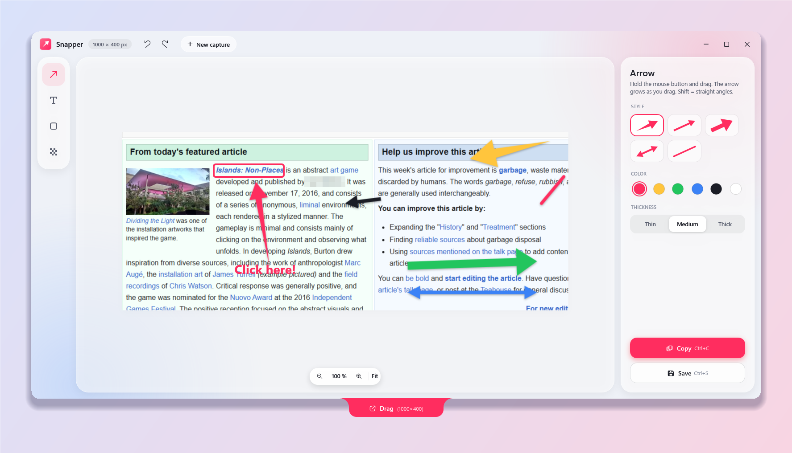
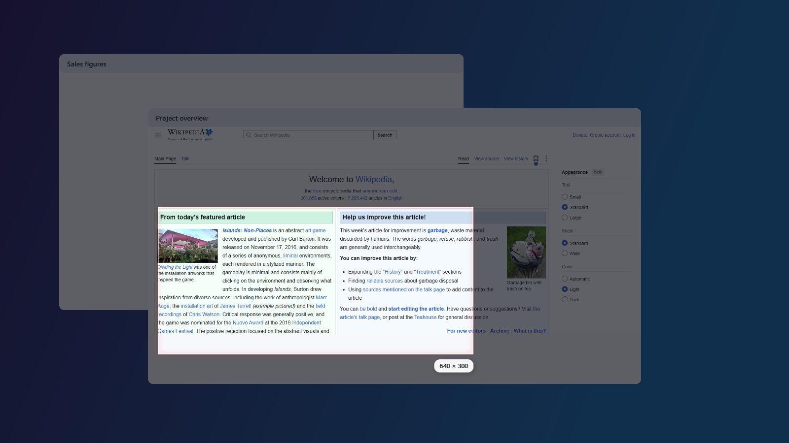

# Snapper

A quick screenshot tool with a built-in editor for Windows. A recreation of the core idea of Skitch.

**English** · [Deutsch](README.de.md)

Start the program → the screen freezes → drag an area → annotate in the editor → copy or save.

## Screenshots

The editor with tools on the left, settings on the right and the red "Drag" tab at the bottom:



The selection: the screen freezes, you drag an area, and the size is shown:



(Example images using a cutout of the Wikipedia main page. Text under [CC BY-SA 4.0](https://creativecommons.org/licenses/by-sa/4.0/), authors see [Wikipedia](https://en.wikipedia.org/wiki/Main_Page).)

## Features

- **Ready instantly:** On start the screen freezes and you drag a rectangle (with a size display). `Esc` cancels.
- **Multiple monitors** and Windows scaling (e.g. 125 %) are supported. The cutout is pixel-exact.
- **Arrow** in Skitch style (pointed at the tail, thick at the head), grows live while you drag. More styles: Straight, Thick, Double, Line. `Shift` snaps the angle.
- **Text**, **Rectangle** and **Pixelate** (not reversible, also good for names and passwords).
- 6 colors, 3 thicknesses, undo and redo.
- **Copy** to the clipboard, **Save** as PNG to `Pictures\Screenshots` (named with date and time).
- **Drag:** The red "Drag" button at the bottom of the editor hands the finished image over as a PNG file. Hold it and drop it into an email, a chat or Explorer. The file lives in `%TEMP%Snapper` and is deleted automatically after 7 days.
- Zoom with `Ctrl` + mouse wheel, pan with the middle mouse button.
- **English and German:** The interface follows the Windows display language (German for German, English for everything else).

## Keyboard shortcuts

| Key | Action |
| --- | --- |
| `A` `T` `R` `P` | Arrow, Text, Rectangle, Pixelate |
| `Ctrl+Z` / `Ctrl+Y` | Undo / Redo |
| `Ctrl+C` | Copy |
| `Ctrl+S` | Save |
| `Ctrl+N` | New capture |
| `Ctrl+0` | Fit view |
| `Esc` | Close editor |

## Build

Requires the [.NET 10 SDK](https://dotnet.microsoft.com/download).

```powershell
# Develop and run
dotnet run --project src\Snapper

# Build the finished Snapper.exe into publish\
powershell -File publish.ps1
```

`Snapper.exe` (about 140 MB) brings .NET with it. Nothing needs to be installed on the machine.
You can pin it to the taskbar. One click starts the selection right away.

Note: The `.exe` is not signed. On the first start after a download Windows may show "Windows protected your PC". Click "More info" and then "Run anyway".

## Publishing a new version

1. Raise `<Version>` in `src\Snapper\Snapper.csproj` (e.g. `1.1.0`).
2. Run `powershell -File publish.ps1`. This builds `publish\Snapper.exe`.
3. On GitHub go to **Releases → Draft a new release**, create a tag that matches the version (e.g. `v1.1.0`) and attach `publish\Snapper.exe`. Click "Publish release".

When the editor opens, Snapper asks GitHub for the latest release (at most every 12 hours). If the version there is higher, an "Update x.y.z available" button appears at the top. A click opens the release page for download. No data about the user is sent. You update by hand: close Snapper and overwrite the old `Snapper.exe`.

## Self-test (for developers)

```powershell
src\Snapper\bin\Debug\net10.0-windows\Snapper.exe --selftest C:\Temp\snapper-test
```

Draws into a sample cutout by code and writes `result.png` (finished image), `window.png` (editor) and `info.txt`. No mouse clicks are simulated.

Optionally add `--bild docs\wikipedia.png` to use your own template image. `--lang de` or `--lang en` forces the language. The images in `docs\` are created with `powershell -File tools\make-screenshots.ps1`.

## Not included yet

Editing and moving arrows and objects afterwards, pen, eraser, crop, global hotkey, window and full-screen selection, blur.

The update check stores its result in `%LOCALAPPDATA%\Snapper\update.json`.
Errors are written to `%LOCALAPPDATA%\Snapper\log.txt`.
